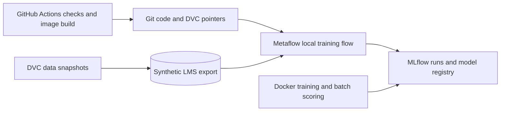

# Local environment

## Architecture



Git records code/configuration and DVC pointer history. DVC versions input files and provides local restore/push/pull mechanics. Metaflow runs the linear training workflow. MLflow records experiments and model versions. Docker supplies repeatable runtimes for training and scoring. GitHub Actions runs checks and builds the image. DVC is not a workflow engine; MLflow is not a scheduler.

## Verified machine and package versions

Verified on 2026-11-20 in the project Python 3.11 environment on macOS arm64. Docker CLI and daemon were reachable. All dependencies are locked in `uv.lock`; `requirements.lock.txt` is the hash-pinned pip export.

| Component | Verified version |
|---|---:|
| Python | 3.11.7 |
| uv | 0.12.4 |
| pandas | 2.3.3 |
| scikit-learn | 1.9.1 |
| MLflow | 3.18.0 |
| Metaflow | 2.19.41 |
| DVC | 3.67.1 |
| boto3 (Metaflow dependency pin) | 1.44.7 |
| pytest | 9.2.0 |
| matplotlib | 3.11.2 |
| PyYAML | 6.0.3 |
| Docker Engine | 28.5.2 |
| Docker base image | `python:3.11-slim-bookworm`, pulled as `python@sha256:a83ba18aef0f865b1a4a611c2cf460fe446f2795673bbb9fe43be570439e3b39` (`linux/arm64`) |

Metaflow 2.19.41 declares an unbounded `boto3` dependency. The direct boto3 pin prevents the resolver from selecting the unrelated historical 0.0.8 release. The complete resolved dependency tree is pinned in the lock files.

## Create and use the environment

```sh
uv python pin 3.11
uv sync --locked
uv run python scripts/verify_synthetic_data.py
uv run pytest
```

The lock fixes exact wheels and hashes. Runtime outputs, local databases, DVC cache/remote, and Python environments are ignored by Git.

## DVC local recovery remote

`data/` is tracked as one DVC bundle. The default remote is configured only in the ignored `.dvc/config.local` and points to `local_dvc_store/` outside `data/`:

```sh
uv run dvc init
uv run dvc add data
uv run dvc remote add --local -d localstore "$PWD/local_dvc_store"
uv run dvc push
uv run dvc pull
```

The same-disk local remote demonstrates restore mechanics; it is not an off-device backup. Keep the original dataset in place during recovery demonstrations. The verified recovery check pulled the DVC pointer into a disposable checkout and matched `data/raw/lms_snapshots.csv` to SHA-256 `f4c3ccfc84626b6bbbaa9a10c7d617a5f67ce1246c768d865d5cd34e3583995d`.

## Verified CLI/API checks

- `dvc --version` reported 3.67.1.
- `mlflow server --help` exposes `--backend-store-uri`, `--artifacts-destination`, `--host`, and `--port` for the planned local SQLite/artifact server command.
- A temporary two-step Metaflow flow passed `show` and `run` on 2.19.41 (run ID `1795190935027835`); its local datastore was isolated under `/private/tmp`.
- The existing generator was rerun; the verifier confirmed 3,600 snapshots, 3,600 outcomes, 853 withdrawals, all manifest checksums, and rejection of the invalid fixture.
- Contract and feature tests passed: `16 passed`.
- DVC recovery pulled the bundle into a disposable checkout and matched the original and temporary-backup SHA-256 for `lms_snapshots.csv`.

## Phase 4 container verification

- Built `student-dropout:local` for `linux/arm64` from the pinned Python image and locked, hash-verified `requirements.lock.txt`.
- Started the Compose MLflow server with its published port bound to `127.0.0.1:5000`, SQLite backend and artifact proxy in the persistent `mlflow_data` volume.
- Ran a complete containerized Metaflow flow through `http://mlflow:5000`; it registered gate-passing model version 1. Promoted version 1 explicitly, then a second container flow loaded it through the strict shared skops loader, passed champion comparison and registered version 2. A further card-viewer verification run registered version 3; the champion remains version 1.
- Scored the 12-row example batch in the container before and after restarting MLflow. Both runs wrote all 12 predictions with finite probabilities and exact version 1; this verified that the registry database, model and run artifacts survived restart.
- Host and container scoring of the same version-1 model and 12-row input matched row keys and model version; maximum absolute probability difference was `1.11e-16` (within `1e-6`).
- Container Metaflow state and cards are bind-mounted at the same absolute project path as the host. Host `card list` and the Local Card Viewer on port 8324 both displayed all eight cards for container run `1795193668049314`.
- MLflow's optional PyFunc input-example check logs a warning while `MLFLOW_ALLOW_MODEL_CODE_EXECUTION=false`; the locked sklearn model and input example are still logged. The shared native sklearn scorer independently validates the registered `skops` artifact's exact `numpy.dtype` allowlist and successfully calls `predict_proba`.

## Primary references

- [Metaflow: constructing flows](https://docs.metaflow.org/api/flowspec)
- [MLflow tracking server](https://mlflow.org/docs/latest/tracking/server/)
- [MLflow CLI reference](https://mlflow.org/docs/latest/api_reference/cli.html)
- [DVC local remotes](https://doc.dvc.org/command-reference/remote/add)
- [Docker Compose getting started](https://docs.docker.com/compose/gettingstarted/)
- [scikit-learn common pitfalls](https://scikit-learn.org/stable/common_pitfalls.html)
- [scikit-learn probability calibration](https://scikit-learn.org/stable/modules/calibration.html)
