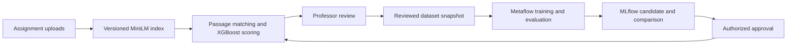

# Professor report review and training integration plan

## Primary goal

A professor can upload an assignment’s reports, inspect matching passages side by side, and use reviewed examples to request XGBoost training. The platform shows progress and a comparison against the active model so an authorized approver can decide which version should score future reports.

The pilot serves one course and assignment at a time. The platform owns identities, access rules, uploaded documents, reviews, and job status. The Python worker owns MiniLM indexing, scoring, XGBoost training, and evaluation. The first scoring release uses a verified existing model after a pilot compatibility check. Training and approval follow once reviewed data is available.

## Phase 0 — Confirm the platform boundary

**How this serves the primary goal.** Choose where uploads, reviews, and job progress live so the professor can complete the workflow inside the platform.

- The repository provides a batch CLI, Docker jobs, and Metaflow and MLflow workflows. The platform’s backend, authentication, storage, and job queue have yet to be identified. Locate those components in the platform repository before naming routes or selecting a new dependency. Agree on the supported upload formats, comparison scope, model scope, training eligibility policy, approval role, and retention policy. [Repository scope](../README.md#scope)
- Use these verified entry points as the integration boundary. The Python worker can use `chunk_text`, `MiniLMEncoder`, `retrieve`, and `score_submissions_with_metrics` for retrieval and scoring. `Document`, `Annotation`, `Pair`, `Corpus`, `assign_splits`, and `save_corpus` define the training input. The Metaflow CLI accepts `--data-dir`, `--config-path`, `--tracking-uri`, `--cache-dir`, `--result-path`, and `--encoder-dir`. Platform HTTP routes and queue handlers are proposed integration work. [Retrieval](../src/plagiarism/retrieval.py#L72) · [Scoring](../src/plagiarism/score.py#L243) · [Corpus contract](../src/plagiarism/data.py#L27) · [Flow parameters](../flows/train_plagiarism_flow.py#L117)
- **Verify:** Record the owner of each integration boundary and identify who may upload, review, train, or approve. Confirm that the pilot can resolve course membership, store versioned documents privately, and run a background worker. The authenticated API must derive scope and worker input locations from platform records.

## Phase 1 — Connect uploads and background jobs

**How this serves the primary goal.** A professor submits a batch and can follow its progress while indexing and scoring run in the background.

- Extend the platform’s existing assignment upload flow. Persist an immutable report version with its assignment, report ID, upload reference, canonical extracted text reference, content hash, extraction version, and status. Use the same text representation for indexing, review highlights, and training offsets. Store a mapping from canonical text positions to the viewer when the original file layout matters.
- Add platform operations to submit a comparison job, check its status, and fetch its results. Return a job ID promptly. Persist `queued`, `running`, `completed`, and `failed` plus the current stage and a useful failure reason. Give each job its own input and output locations. Bind retries to the same operation and input versions, reconcile the worker result before publishing it, and record which authorized account requested the job. Reuse the worker’s argument-list invocation and result-JSON readback pattern. [Worker invocation example](../scripts/plagiarism_fixture_workflow.py#L37) · [Flow result contract](../flows/train_plagiarism_flow.py#L524)
- Use the platform’s API conventions for the proposed operations below. The platform resolves each reference within the caller’s authorized scope.

| Operation | Input supplied by the platform | Result |
|---|---|---|
| Check reports | Assignment and selected report version IDs | Comparison job ID |
| Read job | Comparison or training job ID | Stage, status, and result reference on completion |
| Save review | Candidate or document pair ID, verdict, and corrected spans when applicable | Versioned review ID |
| Train a model | Reviewed dataset snapshot ID and approved training preset | Training job ID |
| Approve or roll back | Concrete candidate or previously approved release ID | Active release ID and audit reference |

- **Verify:** Upload two sample reports, retry the same job, and confirm one visible result. Prove that invalid extraction produces a clear error and an out-of-scope account cannot retrieve the input, excerpts, or job status. The service accepts platform IDs and constructs its own file paths, queue payloads, and runtime arguments.

## Phase 2 — Compare reports in an assignment index

**How this serves the primary goal.** Group A and Group B can upload in the same batch and see matching passages from each other’s reports.

- Build one immutable index snapshot from all eligible reports in that batch and any approved reference documents. Commit the snapshot before scoring. Record assignment scope, source document versions, content hashes, encoder revision, chunking configuration, and index checksum. Add both groups’ reports as eligible sources. Exclude each query’s own report from its allowed source IDs before top-k ranking. Deduplicate mirrored alerts for display while preserving the original evidence and keeping identical text in distinct reports detectable. [Source builder](../src/plagiarism/candidates.py#L23) · [Source filtering](../src/plagiarism/retrieval.py#L214) · [Cache writer](../src/plagiarism/retrieval.py#L254)
- Add a platform scoring path with two verified inputs. The model input contains the concrete registered version, gate report, threshold, fitted features, and encoder configuration. The assignment index has its own scope, version, checksum, and compatible encoder and chunking configuration. Preserve the existing CLI’s exact frozen-index verification. For platform scoring, pin the model and index for the entire job, reuse the existing feature and XGBoost score path, and return versioned offsets, excerpts, and review scores. A changed index must pass compatibility and pilot scoring checks before use. [Release validation](../src/plagiarism/score.py#L61) · [Scoring records](../src/plagiarism/score.py#L243)
- **Verify:** Two same-batch reports produce the expected match and no self-match. Changing an upload changes the index version. A mismatched hash, encoder, or scope fails before scoring. The batch CLI continues to reject a different index passed as a source manifest. [Scoring test patterns](../tests/test_plagiarism_score.py#L34)

## Phase 3 — Collect judgments and freeze training data

**How this serves the primary goal.** The professor’s review decisions become labeled examples that can be audited and reused for training.

- Show both excerpts with document context. Let reviewers mark reuse, dismiss a candidate, mark uncertainty, adjust spans, or select an overlooked source manually. Include a sample below the review threshold and allow reviewers to add missed spans. Save the reviewed document versions, exact character offsets, review author, history, and scope. Treat the output as evidence for review and let the professor decide whether citation or other context matters.
- For the pilot, export a document pair only after a reviewer confirms pair-level coverage. Include all confirmed span alignments for a positive pair. Export a negative pair only after the reviewer confirms the full pair has no qualifying reuse. Preserve individual candidate decisions separately. This matters because the existing training code treats windows without annotated overlap as negatives. A single dismissed passage is insufficient to label the entire document pair. Resolve conflicting labels before freezing the snapshot. Keep uncertain and unreviewed judgments outside the training export. [Pair validation](../src/plagiarism/data.py#L308) · [Candidate labels](../src/plagiarism/evaluation.py#L20)
- Export a private, immutable `manifest.json` with scope, dataset checksum, review revisions, split policy, and label counts. Reuse the group splitter so exact copies and linked documents stay together. If a report appears in both query and source roles, map those IDs back to the same logical report and group. Keep both classes and enough independent groups in train and validation. Reserve a fresh holdout when the pilot has enough reviewed data. Record insufficient data as a training readiness status. [Group splitting](../src/plagiarism/data.py#L341) · [Corpus export](../src/plagiarism/data.py#L444)
- **Verify:** Duplicate text and linked reports stay in one split, Unicode highlights round-trip, uncertain and partially reviewed pairs stay outside the export, and the same frozen reviews reproduce the same dataset hash. Confirm the evaluation set includes known missed spans so retrieval recall reflects misses as well as retrieved candidates. [Corpus test patterns](../tests/test_plagiarism_data.py#L53)

## Phase 4 — Train and compare XGBoost candidates

**How this serves the primary goal.** The professor can request training, see how the candidate compares with the active model, and understand the release decision.

- Run the existing Metaflow pipeline from a background job using the frozen manifest, pinned MiniLM encoder, scoped MLflow experiment, and isolated cache and result paths. Use the current per-snapshot DVC verification pattern or define an equivalent private snapshot verifier before replacing that dependency. Keep MiniLM frozen and fit the existing feature transforms on train only. Log the dataset hash, split counts, hyperparameters, software and model revisions, gate evidence, and Metaflow run ID. [Data verification](../flows/train_plagiarism_flow.py#L164) · [Training configuration](../flows/train_plagiarism_flow.py#L290)
- Add active-model comparison using the same authorized validation snapshot, candidate-generation protocol, and metric definitions. The existing gate compares against MiniLM cosine. Keep that baseline visible and add the active XGBoost release as the comparison for replacement. Compare alert precision, recovered spans, and false alerts at comparable recall. Choose the candidate’s threshold on validation. Report the active model’s deployed threshold separately when evaluating it at the joint recall target. Record gate failures and data sufficiency in the job result. Evaluate any reserved holdout after freezing one candidate and its threshold, using a fresh evaluation record. [Validation flow](../flows/train_plagiarism_flow.py#L366) · [Gate logic](../src/plagiarism/evaluation.py#L195) · [Frozen evaluation pattern](PLAGIARISM_RUNBOOK.md#use-pan-data-and-frozen-minilm)
- **Verify:** From the same snapshot the active and candidate models see the same judged validation cases. A failed gate yields a visible explanation and no eligible release. Prove that held-out cases are outside fitting and threshold selection. The platform reads run state and metrics using a scoped service identity and displays the necessary summaries to professors.

## Phase 5 — Approve and roll back a concrete version

**How this serves the primary goal.** An authorized person can activate a passing candidate, and subsequent comparison jobs use that version with a compatible index.

- Make candidate completion and activation separate actions. Show the version, scope, dataset revision, validation comparison, and gate result. On approval, resolve the concrete registry version, verify its bundle, and atomically update the platform’s active release reference. Keep the previous version for rollback. Serialize approve and rollback per model scope, record actor and reason, and reconcile the registry and platform state after failure. The existing promotion and rollback scripts demonstrate the audit and compensation pattern for local use. [Promotion pattern](../scripts/promote_model.py#L27) · [Rollback pattern](../scripts/rollback_model.py#L27)
- Define retention and access for text-bearing artifacts before piloting with student reports. The current source cache serializes chunk text, and Metaflow carries text in intermediate records. Keep datasets, indexes, excerpts, and intermediate artifacts under scoped access. Use opaque IDs and aggregate metrics in shared logs and verify that removal or expiry follows the platform’s approved retention policy. [Source cache format](../src/plagiarism/retrieval.py#L254) · [Training artifacts](../flows/train_plagiarism_flow.py#L290)
- **Verify:** An authorized approval changes the version used by new jobs. Running jobs finish with their pinned version. Concurrent approvals or retries produce a consistent audit. Rollback restores earlier predictions on the same input and index. An unauthorized user cannot request activation or view the underlying report artifacts.

## Phase 6 — Rehearse the entire pilot

**How this serves the primary goal.** The team can demonstrate upload through approved scoring and diagnose failures before the first course uses it.

- Run an end-to-end rehearsal with authorized sample reports covering copied text, paraphrasing, and same-topic independent work. Include upload, matching, reviewing, adding a missed span, freezing a dataset, training, a failed gate, an approved candidate, and rollback. Compare the evidence records with the original report text at the stored offsets. [Fixture workflow](PLAGIARISM_RUNBOOK.md#run-the-end-to-end-fixture-workflow)
- **Verify:** Run `python -m pytest -q` in the repository runtime, the isolated plagiarism fixture workflow, and the platform’s integration suite. Add checks for cross-assignment isolation, private artifact access, deterministic dataset creation, job retries, active-model comparison, and release rollback. Include a real MiniLM offline smoke check and a versioned audit record for the pilot. [Encoder smoke check](PLAGIARISM_RUNBOOK.md#use-pan-data-and-frozen-minilm) · [Evaluation test patterns](../tests/test_plagiarism_workflow_eval.py#L46)

## First release and follow-ups

Ship upload, same-assignment scoring, and professor review first. Enable the training and approval actions after the pilot has enough audited labels and the active-model comparison is working. Follow-up work can cover institution-wide reference sharing, candidate-level training from partially reviewed pairs, and continuous retraining policies.
