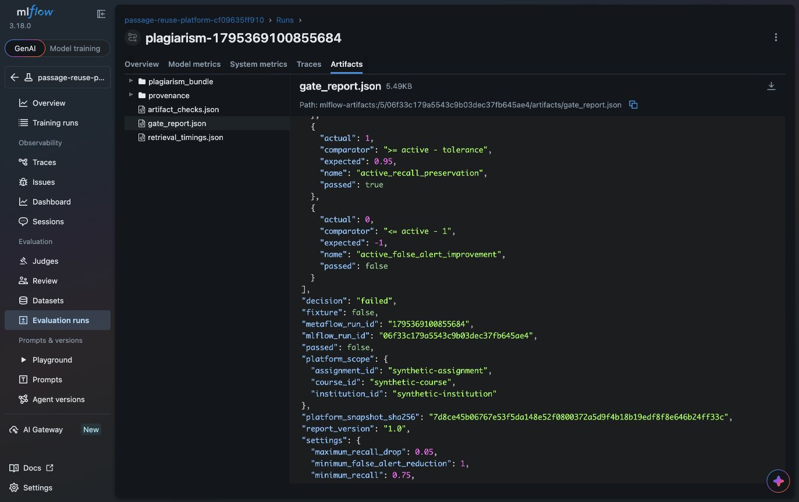
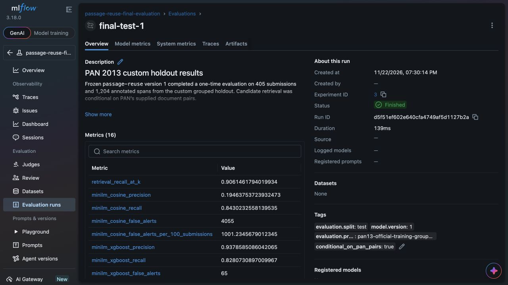
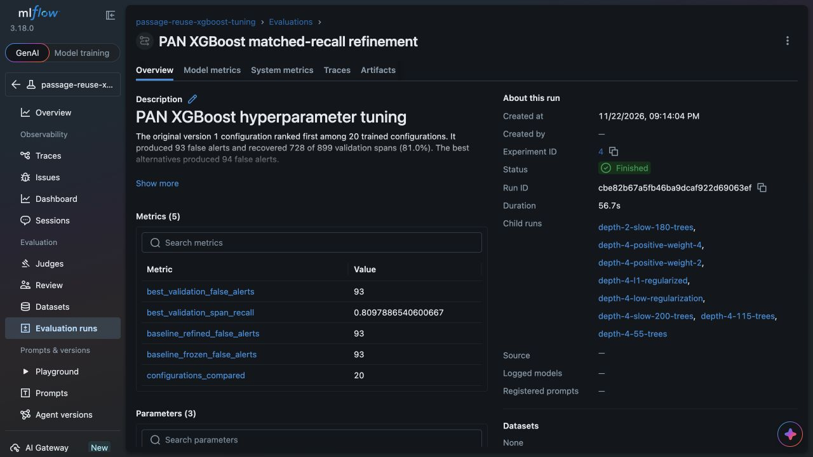

# Professor demo for the passage reuse pipeline

Try the [interactive professor demo](https://maxser0v.github.io/student-dropout-mlops/) and its [Metaflow walkthrough](https://maxser0v.github.io/student-dropout-mlops/metaflow.html). The browser demo uses sample reports and simulates training and approval.

Start with two sample reports, then follow the evidence into Metaflow and MLflow. **Metaflow runs the steps. MLflow records their metrics, artifacts, and model versions.** The platform worker already scores a batch and exports completed reviews. A platform backend would supply authenticated uploads and professor judgments, schedule jobs, and activate an approved release. [Worker integration guide](PLAGIARISM_PLATFORM_WORKER.md)

## What was validated on 23 November 2026

| Check | Observed result |
|---|---|
| Repository tests | 110 passed |
| Isolated plagiarism tests | 40 passed |
| Fresh synthetic Metaflow and XGBoost rehearsal | Two passing concrete versions, one rejected candidate, and identical scoring output after rollback to version 1 |
| Saved assignment scoring | Two reports produced two directional evidence records and one professor-facing match. The saved retry completed against the same output path. |
| Saved platform training | Metaflow `1795369100855684` trained on a verified synthetic review snapshot, compared against `passage-reuse/1`, and completed with a failed release gate. |

The fixture rehearsal ran again for this check. The assignment-scoring and platform-training evidence comes from the saved Docker runs. The current shell could not reach the Docker socket. MLflow opened in the browser. I exported the Metaflow card directly from the fresh fixture and the browser blocked its local HTML URL. Open the saved card manually on the demo Mac. [Fresh rehearsal report](../reports/plagiarism/professor-validation-NaJak2/workflow-summary.json) · [Saved scoring result](../reports/plagiarism/platform-score-x3qI3h/result.json) · [Metaflow card](../reports/plagiarism/professor-validation-NaJak2/metaflow-fixture-card.html)

## 1. Start with two reports

**Show:** Open the saved scoring result. Expand `display_flags[0].representative` and point at `query_report_id`, `source_report_id`, both excerpts, and both pairs of character offsets. `group-b` matched `group-a` with a MiniLM cosine of `1.0` and an XGBoost review score of about `0.997`. One review item contains two evidence IDs because the worker found A against B and B against A. [Saved scoring result](../reports/plagiarism/platform-score-x3qI3h/result.json)

**Explain:** The worker indexes the two approved report versions together. MiniLM splits the text into overlapping windows, converts each window to a 384-dimensional embedding, and retrieves the nearest source windows. The worker excludes every version of the query report from its own search. XGBoost then scores each pair using MiniLM similarity, TF-IDF similarity, shared word sequences, rare-term overlap, and passage length ratio. The threshold determines which excerpts the professor sees for review. [Scoring contract](PLAGIARISM_PLATFORM_WORKER.md#score-reports)

To display the result without reading the entire JSON file, run this from the repository root.

```sh
jq '{model, index, display_flags: [.display_flags[] | {
  evidence_count: (.evidence_ids | length),
  match: (.representative | {query_report_id, source_report_id,
    query_excerpt, source_excerpt, minilm_cosine, review_score})
}]}' reports/plagiarism/platform-score-x3qI3h/result.json
```

## 2. Show where the training labels come from

**Explain:** A professor checks the passages in context and records completed document-pair judgments with corrected offsets. A positive example includes all confirmed reuse spans. A negative example is a fully reviewed pair with no qualifying reuse. Uncertain and partially reviewed pairs stay outside the training snapshot. `snapshot` exports `manifest.json` and its SHA-256 checksum. Related reports and exact copies stay in the same partition. [Snapshot contract and example](PLAGIARISM_PLATFORM_WORKER.md#freeze-reviewed-examples)

**Show:** In the [saved platform run](http://127.0.0.1:5001/#/experiments/5/runs/06f33c179a5543c9b03dec37fb645ae4), open **Artifacts → provenance → data_checks.json**. Point at the input manifest checksum, `pair_label_counts`, and the platform scope. The synthetic example supplied 18 training pairs and 3 validation pairs after splitting. [Training handoff](PLAGIARISM_PLATFORM_WORKER.md#training-handoff)

## 3. Walk through Metaflow

**Show:** Open the [exported Metaflow card](../reports/plagiarism/professor-validation-NaJak2/metaflow-fixture-card.html). It belongs to the first successful run of the fresh synthetic rehearsal. Use the graph as a map, then explain the steps in order.

| Metaflow step | What to show or say |
|---|---|
| `start` and `validate` | Read the config, verify the reviewed manifest and its scope for a platform run, and check that train and validation have both label classes. |
| `prepare` | Use the frozen encoder to retrieve candidate passages. Generate the five features and discard ambiguous partial matches from training. |
| `train` and `log_model` | Fit XGBoost. Save the model and its supporting artifacts and verify that the reloaded model reproduces predictions. |
| `evaluate` and `gate` | Select the review threshold on validation. Compare false alerts at similar recall against MiniLM cosine and, for platform training, the active XGBoost version. |
| `register` and `end` | A passing candidate gets a concrete registry version. The result JSON records the decision and both run IDs. Activation is a separate approval action. |

**Run it live if you have time:** The following uses the installed isolated runtime and a fresh private directory. It demonstrates the training and release workflow using an authored fixture and real XGBoost. The fixture uses a deterministic stand-in for the encoder. The saved platform run and assignment-scoring result show real MiniLM.

```sh
DEMO_DIR=$(mktemp -d "$PWD/reports/plagiarism/professor-demo-XXXXXX")
mkdir -p "$DEMO_DIR/metaflow"
export METAFLOW_USER=student-mlops
export METAFLOW_DATASTORE_SYSROOT_LOCAL="$DEMO_DIR/metaflow"
export METAFLOW_CARD_LOCALROOT="$DEMO_DIR/cards"
export MLFLOW_DISABLE_AGENT_HINT=1 MLFLOW_ALLOW_MODEL_CODE_EXECUTION=false
PY="$PWD/plagiarism-runtime/.venv/bin/python"

"$PY" scripts/plagiarism_fixture_workflow.py \
  --tracking-uri "sqlite:///$DEMO_DIR/mlflow.db" \
  --output-dir "$DEMO_DIR"

RUN_ID=$(jq -er '.metaflow_run_id' "$DEMO_DIR/train-1.json")
END_TASK=$("$PY" -c 'import sys; from metaflow import Run; print(Run("PlagiarismTrainingFlow/" + sys.argv[1])["end"].task.id)' "$RUN_ID")
CARD_TASK="$RUN_ID/end/$END_TASK"
"$PY" flows/train_plagiarism_flow.py card create --type default \
  --id professor_demo "$CARD_TASK"
"$PY" flows/train_plagiarism_flow.py card get --id professor_demo \
  "$CARD_TASK" "$DEMO_DIR/metaflow-card.html"
cat "$DEMO_DIR/workflow-summary.json"
```

Open the exported `metaflow-card.html`. On a machine that allows a local viewer, use `"$PY" flows/train_plagiarism_flow.py card server` with the same Metaflow environment and visit [port 8324](http://127.0.0.1:8324). The SQLite tracker for this new fixture is separate from the historical MLflow dashboard on port 5001. [Fixture runbook](PLAGIARISM_RUNBOOK.md#run-the-end-to-end-fixture-workflow)

## 4. Use MLflow to explain a completed run that failed its gate

**Show:** Open [this platform training run](http://127.0.0.1:5001/#/experiments/5/runs/06f33c179a5543c9b03dec37fb645ae4). In **Overview**, find `release_gate_passed = 0`, `active_model_name = passage-reuse`, `active_model_version = 1`, and the `metaflow.run_id` tag. Then go to **Artifacts → gate_report.json** and scroll to `checks` and `decision`.



**Explain:** The job finished normally and produced a model artifact. The active model and candidate both recovered the two synthetic validation spans with zero false alerts. The policy required the candidate to reduce false alerts, so it did not qualify for registration. The matching Metaflow run ID identifies the execution that produced the MLflow evidence. The fixture rehearsal separately shows two passing versions, a deliberately rejected candidate, and rollback restoring the original scoring output. [Rehearsal summary](../reports/plagiarism/professor-validation-NaJak2/workflow-summary.json)

**Show the passing case:** Open the [PAN training run](http://127.0.0.1:5001/#/experiments/1/runs/2f1ee43689c349dd93d8a70222fc75d9). In **Artifacts → deployment_bundle.json**, point at `model_version`, `threshold`, and the encoder and index checksums. These identify what the worker uses when asked to score with version 1.

## 5. Close with the real-data results and the tuning trade-off

**Show:** Open [the saved PAN held-out evaluation](http://127.0.0.1:5001/#/experiments/3/runs/d5f51ef602e640cfa4749af5d1127b2a). Start with the comparison in **Overview**, then open **Artifacts → final_test_metrics.json** if asked for the raw evidence. On this custom holdout, MiniLM cosine produced 4,055 false alerts at 84.3% span recall. MiniLM plus XGBoost produced 65 false alerts at 82.8% recall and 93.8% alert precision. [PAN evaluation methods](PLAGIARISM_RESULTS.md#held-out-results)



**Show:** Open the [XGBoost tuning comparison](http://127.0.0.1:5001/#/experiments/4/runs/cbe82b67a5fb46ba9dcaf922d69063ef) and click **Show more** under the run description for the trial table. Point out that two configurations each recovered 728 validation spans. The 80-tree model with learning rate 0.08 produced 93 false alerts. The 50-tree model with learning rate 0.14 produced 94. The 80-tree configuration ranked first in the 20-run comparison. [Tuning findings](PLAGIARISM_RESULTS.md#xgboost-tuning-findings)



**Closing line:** “MiniLM finds passages to compare, XGBoost helps prioritize review, and the validation gate gives us a reproducible reason to accept or reject a new candidate.”
